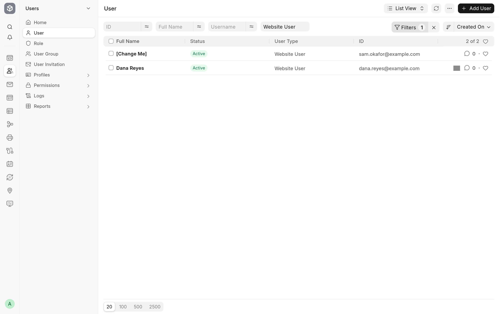

When **Enable New User Registration** is on, a person whose identity provider lets them in does not need a Frappe user beforehand. The first valid token for a new email creates one, and the person is logged in on the same request.

## When a user is created

The app creates a user when all of these hold:

- **Enable JWT User Auth** and **Enable New User Registration** are on.
- The request carries a valid token with an `email` claim. See [Sign in with a token](sign-in.md#what-the-app-checks).
- No user has that email as its ID, and the first Contact found with that email is not linked to a user.

With **Enable New User Registration** off, such a token logs nobody in, and the person stays a guest.

Every user the app creates is a Website User with no roles, and Frappe sends no welcome email. The user has no Frappe password: they sign in through the provider.

## From an existing Contact

If a Contact has the email, the new user is filled in from it: **First Name**, **Middle Name**, **Last Name**, **Full Name**, **Gender**, **Phone** and **Mobile No**. The user's **Username** is the email. The Contact's **User Id** field is then set to the new user, so the two are linked.

When the Contact has a first name, the person goes straight on to the page they asked for. When it has none, the user's first name is set to `[Change Me]` and the person is asked to complete their profile, as below.

## Without a Contact

If no Contact has the email, the user is created with the first name `[Change Me]` and nothing else, and the person is asked to complete their profile. Frappe then creates a Contact for the new user, named after it: `[Change Me]`, or `[Change Me]-1` and so on when that name is taken.

## Completing the profile

A person asked to complete their profile is sent, on that first request, to Frappe's **Update Profile** form at `/update-profile/<EMAIL>/edit`, where `<EMAIL>` is their address.

1. Replace `[Change Me]` in **First Name** with your first name. It is the only required field.
2. Fill in **Last Name** and any other details you want on your account.
3. Click **Save**.

Frappe's form then opens **My Account** (`/me`), and the app sends the person on to the page they first asked for. Only the path of that page is kept, not its query string.

## Keep the user in step with the Contact

Whenever a Contact that is linked to a user is saved, the app copies to that user any of these fields that changed on the Contact: **First Name**, **Middle Name**, **Last Name**, **Full Name**, **Phone**, **Mobile No** and **Gender**. This applies to every linked Contact, not only to ones the app created.

The app also tidies up the `[Change Me]` placeholder. When a Contact whose name contains `[Change Me]`, or whose full name is `[Change Me]`, gets a real name, the app sets its **Full Name** and renames the Contact to that name, adding a number such as `-1` if another Contact already has it. The rename runs as a background job, so it needs the bench's workers running.

For a person who completed their profile, this happens on its own: saving the profile updates the User, Frappe copies the new name to the user's Contact in a background job, and the app then renames that Contact.

## Give a new user more access

Users created from a token can use the website and its portal pages but not the desk. To give one desk access, open the user in **User**, add the roles they need and save. Frappe makes a user with desk roles a System User.
